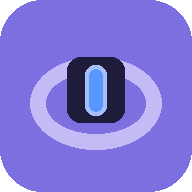
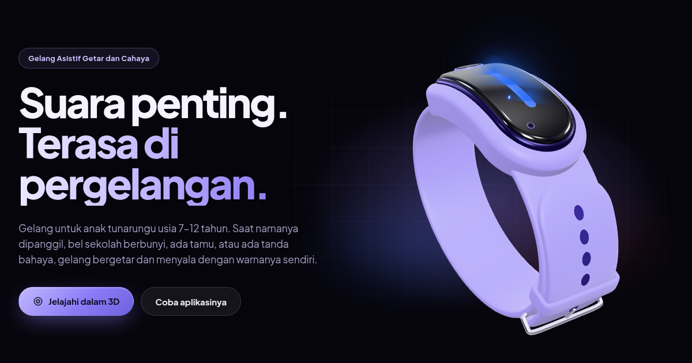
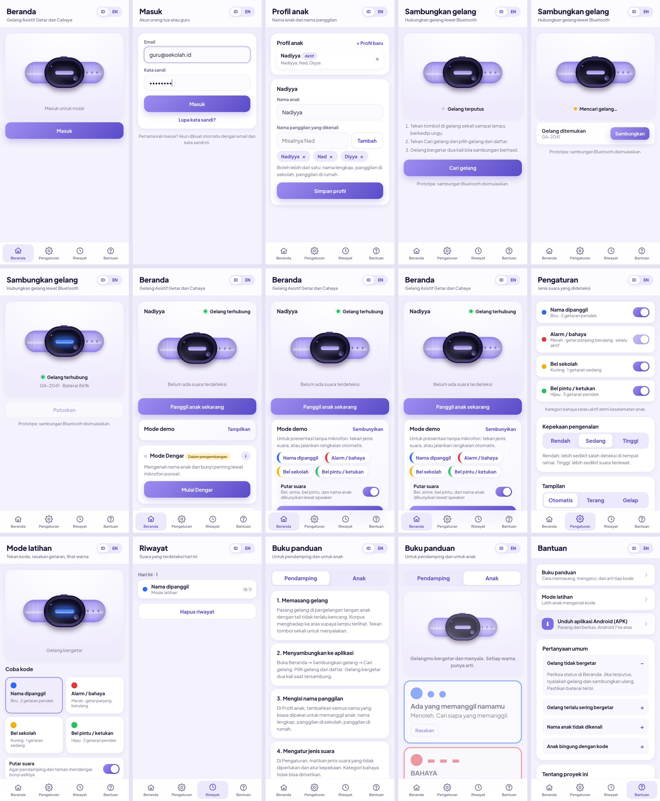
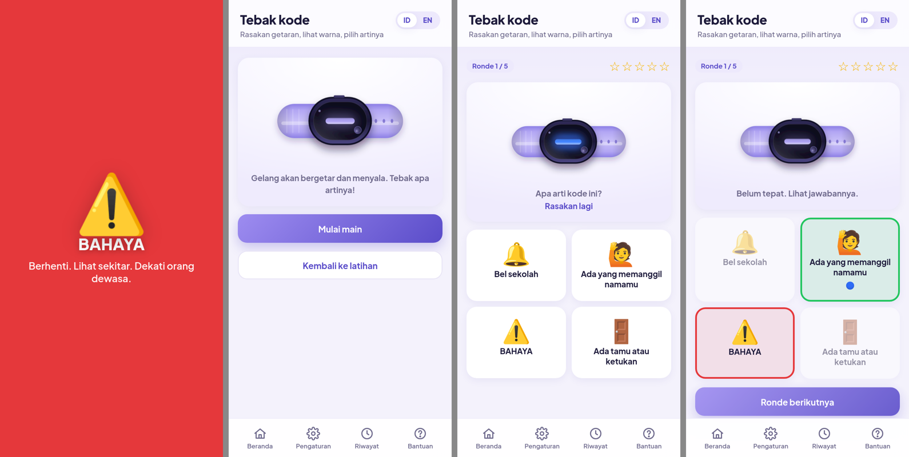
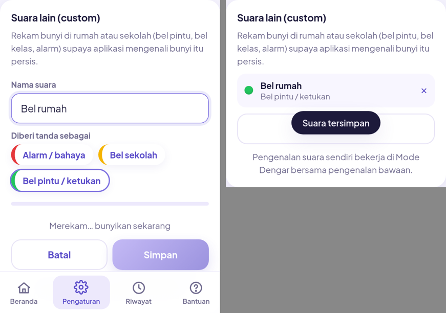

<div align="center">



# Gelang Asistif Getar dan Cahaya

**Приложение-компаньон для ассистивного браслета, который переводит важные звуки в вибрацию и цвет.**

Для глухих детей 7–12 лет · SLB-B и инклюзивные школы Индонезии · интерфейс на индонезийском

[](https://gelang-asistif-3023.web.app)
[](https://github.com/IvanFrost23/gelang-asistif-releases/releases/latest/download/gelang-asistif.apk)
[](https://gelang-asistif-3023.web.app/gelang/)
[](#стек)
[](#режим-dengar)
[](#стек)

<br>

&nbsp;
&nbsp;
&nbsp;


</div>

---

## О проекте

Браслет надевается на руку ребёнка. Когда рядом звучит его имя, школьный звонок, дверной звонок или сирена,
браслет вибрирует определённым паттерном и зажигает светодиод своим цветом. Приложение принадлежит родителю
или учителю: оно слушает микрофон, распознаёт звук и отправляет код на браслет.

Железо в рамках курса не собирается, поэтому приложение работает как интерактивный прототип.
Роль браслета играет сам телефон: анимированный браслет на экране плюс настоящая вибрация на Android.

Проект выполнен в рамках курса **Teknologi Asistif**, S1 Pendidikan Khusus, Fakultas Ilmu Pendidikan,
Universitas Negeri Surabaya, 2026.

| | |
|---|---|
| **Команда** | Ichwan Maulal Hafif, Nadiyya Nur Savira, Hawa Istiqomah, Yoshelyn Shalom P., Ismi Nafisah |
| **Преподаватель** | Ima Kurrotun Ainin, S.Pd., M.Pd. |
| **Книга проекта** | [`docs/tugas-teknologi-asistif.pdf`](docs/tugas-teknologi-asistif.pdf) · [карточка прототипа](docs/prototype-card.jpg) |

## Попробовать

| Где | Как |
|---|---|
| 🌐 **Веб** | [gelang-asistif-3023.web.app](https://gelang-asistif-3023.web.app). Полный набор функций в Chrome на Android. |
| 🧊 **Промо-страница** | [gelang-asistif-3023.web.app/gelang](https://gelang-asistif-3023.web.app/gelang/). Презентация браслета с интерактивной 3D-моделью, ID / EN. |
| 🤖 **Android** | [Скачать APK](https://github.com/IvanFrost23/gelang-asistif-releases/releases/latest/download/gelang-asistif.apk) (Android 7+, Capacitor). Также кнопка на экране Bantuan. |
| 🎛 **Без микрофона** | На главной включите **Mode demo**: события порождаются кнопками или по таймеру. Работает на любом устройстве. |

## Промо-страница браслета

<a href="https://gelang-asistif-3023.web.app/gelang/"></a>

Отдельная страница в духе презентации нового смартфона, адрес `/gelang/`. Тёмный дизайн, крупная типографика, переключатель языка ID / EN.

- **Hero.** Браслет парит, поворачивается за курсором и по очереди показывает четыре кода.
- **Коды.** Карточки прокручиваются, а закреплённый браслет проигрывает активный код: цвет, мигание и дрожание по реальному паттерну. На Android кнопка «Rasakan» вибрирует телефоном.
- **Внутри.** По мере прокрутки корпус раскладывается на слои: стекло, плата с LED и кнопкой, ESP32, батарея и мотор, контакты зарядки.
- **3D-модель.** Вращение, зум, точки на деталях, карточка с описанием каждой детали, режим «Lihat dalam», проигрывание кодов. На телефоне вращение включается по нажатию, чтобы не мешать прокрутке. Сама страница не масштабируется, зум щипком или колесом работает только у модели.
- **Дальше.** Как это работает, скриншоты приложения, спецификации со статусом прототипа, ссылки на веб-версию, APK и код, команда.

Модель браслета построена кодом на three.js по карточке прототипа и таблице компонентов из книги, без внешних 3D-файлов.

## Коды сигналов

Четыре кода. Каждый различим по одной только вибрации, чтобы работать на солнце и для детей с нарушением цветовосприятия.


| Звук | LED | Вибрация | Чему учим ребёнка |
|---|---|---|---|
| 🔵 Назвали по имени | синий | 2 короткие | обернуться, найти зовущего |
| 🔴 Опасность: сирена, клаксон, тревога | красный, быстро мигает | длинная, повторяется | остановиться, осмотреться, подойти к взрослому |
| 🟡 Школьный звонок | жёлтый | 1 средняя | перейти к следующему занятию |
| 🟢 Домашние звуки: дверной звонок, стук | зелёный | 3 короткие | сообщить родителям |

Категория «опасность» не отключается в настройках.

## Возможности

- **Профили детей.** Один аккаунт, несколько профилей, у каждого ребёнка несколько имён, на которые он откликается.
- **Подключение браслета.** Симулированный Bluetooth, статус и батарея на главном экране.
- **Режим Dengar.** Распознавание с микрофона: имя через Web Speech API, классы звуков через YAMNet локально на устройстве.
- **Свои звуки.** Запись конкретного дверного звонка или школьного звонка, сравнение по эмбеддингам YAMNet.
- **Ручной вызов.** Взрослый вызывает ребёнка прямо из приложения, если распознавание не сработало.
- **Режим тренировки.** Кнопка на каждый код, браслет на экране показывает цвет и паттерн, телефон вибрирует.
- **Игра «Tebak kode».** Ребёнок угадывает значение кода по вибрации и цвету, звёзды и рекорд.
- **Вспышка на весь экран** при сигнале, чтобы реакция была заметна даже без взгляда на браслет.
- **История событий (Riwayat).** Время, категория, источник каждого сигнала.
- **Guidebook.** Раздел для взрослого и раздел для ребёнка с крупными картинками кодов.
- **Firebase.** Вход по email, профили и настройки синхронизируются через Firestore, локальный режим как запасной.
- **Тёмная тема и два языка.** ID / EN, тема по системе или вручную.

<details>
<summary><b>Все экраны приложения</b></summary>
<br>

<br><br>

<br><br>

</details>

## Как это работает


### Режим Dengar

1. Приложение один раз запрашивает доступ к микрофону, статус показан на главной.
2. Один аудиопоток делится между Web Speech API (язык `id-ID`) и YAMNet в TensorFlow.js.
3. Событие проходит фильтр: категория включена, уверенность выше порога чувствительности, с прошлого события той же категории прошло больше 3 секунд.
4. Событие записывается в историю и уходит «браслету»: анимация на экране плюс Vibration API.

**Ограничения прототипа.** Нужен Chrome на Android и HTTPS. На iPhone Web Speech API ограничен и нет Vibration API, остаётся демо-режим.
Распознавание имени уходит в облако Google, YAMNet работает полностью локально. В шумном классе точность средняя,
поэтому есть порог чувствительности и ручной вызов.

## Стек

| Слой | Решение |
|---|---|
| UI | React 18, TypeScript, react-router-dom 6, Vite 6 |
| Состояние | zustand с persist в localStorage |
| Распознавание речи | Web Speech API (`id-ID`) |
| Классификация звуков | YAMNet, TensorFlow.js, модель в `public/yamnet` |
| Вибрация и звук | Vibration API, Web Audio API, SpeechSynthesis |
| Аккаунты и данные | Firebase Auth (email), Firestore |
| Хостинг | Firebase Hosting |
| Android | Capacitor 6 |
| Дизайн | Plus Jakarta Sans, CSS-токены, светлая и тёмная тема |
| 3D на промо-странице | three.js, процедурная модель браслета |

Vite 6 и React 18 закреплены из-за Node 22.2 на машине разработки.

## Запуск

```bash
npm install
npm run dev                                   # локально
npm run build && firebase deploy --only hosting
npx cap sync android && (cd android && ./gradlew assembleRelease)   # APK, нужны ANDROID_HOME и JAVA_HOME
./scripts/build-docs.sh                       # PDF документации
node scripts/screenshots.mjs                  # скриншоты всех экранов
node scripts/promo-assets.mjs                 # превью и запасной рендер для /gelang/ (нужен dev-сервер)
```

Переменные окружения для Firebase в `.env.example`.
Новая версия APK: `gh release create v1.x docs/gelang-asistif.apk --repo IvanFrost23/gelang-asistif-releases`.
Ссылка «latest» в `src/app/links.ts`.

## Документация

| Документ | Для кого |
|---|---|
| [Panduan pengguna](docs/manual/panduan-pengguna.md) · [PDF](docs/manual/panduan-pengguna.pdf) | Родитель и учитель: установка, вход, профиль, подключение, настройки, тренировка, Dengar. Плюс карточка кодов для ребёнка. |
| [Техническая документация](docs/dev/dokumentasi-teknis.md) · [PDF](docs/dev/dokumentasi-teknis.pdf) | Разработчик: архитектура, модули, распознавание, сборка и деплой. |
| [`docs/`](docs/) | Книга проекта, карточка прототипа, схема, скриншоты, APK. |

## Структура

```
src/
  app/        маршруты и внешние ссылки
  domain/     коды сигналов: категории, цвета, паттерны вибрации
  events/     конвейер событий: фильтр, антидребезг, история
  listen/     режим Dengar: Web Speech API, YAMNet, свои звуки
  components/ браслет (SVG), панель Dengar, симулятор, вспышка
  screens/    Masuk, Profil, Sambungkan, Beranda, Pengaturan, Latihan, Quiz, Riwayat, Panduan, Bantuan
  store/      zustand, синхронизация с Firestore
  i18n/       словари ID / EN
  promo/      промо-страница: секции, тексты ID / EN, 3D-модель и сцены (three/)
gelang/      точка входа промо-страницы /gelang/
public/yamnet модель YAMNet
docs/         материалы для книги и документация
scripts/      PDF, скриншоты, сид данных, картинки промо-страницы
```

## Что осталось сделать вручную

1. ~~Включить Email/Password в консоли Firebase~~ сделано 2026-10-17.
2. Проверить на реальном Android в Chrome: вибрация, микрофон, распознавание имени.
3. Вписать в книгу название продукта, вставить схему `docs/alur-kerja-produk.png` и скриншоты из `docs/screens/`.

<details>
<summary><b>План работ (все 12 шагов выполнены)</b></summary>
<br>

| Шаг | Что делаем | Результат |
|---|---|---|
| 0 | Скелет проекта, исходные материалы, README, GitHub | ✅ 2026-10-15 |
| 1 | Каркас: роутер, нижняя навигация Beranda / Pengaturan / Riwayat / Bantuan, сиреневая тема, макет 430px | ✅ 2026-10-16 |
| 2 | Домен сигналов, SVG-браслет с анимацией четырёх паттернов, хук Vibration API | ✅ 2026-10-17 |
| 3 | Экраны по книге: вход, профиль с несколькими именами, подключение, главная с ручным вызовом, настройки, тренировка | ✅ 2026-10-17 |
| 4 | Состояние и хранение: zustand + localStorage, несколько профилей, история событий | ✅ 2026-10-17 |
| 5 | Симулятор: события по кнопке и по таймеру, идут в историю и на браслет | ✅ 2026-10-17 |
| 6 | Guidebook для взрослого и ребёнка, экран Bantuan | ✅ 2026-10-17 |
| 7 | Dengar, часть 1: микрофон, Web Speech API, поиск имён, обработка отказа | ✅ 2026-10-17 |
| 8 | Dengar, часть 2: YAMNet через TensorFlow.js, карта классов, порог, антидребезг | ✅ 2026-10-17 |
| 9 | Firebase: Auth по email, Firestore, правила; локальный режим как запасной | ✅ 2026-10-17 |
| 10 | Деплой на Firebase Hosting | ✅ 2026-10-17 |
| 11 | Материалы для книги: 15 скриншотов, схема Alur Kerja Produk, PWA-манифест, APK | ✅ 2026-10-17 |
| 12 | Руководство пользователя (ID), памятка для ребёнка, техническая документация, PDF | ✅ 2026-10-17 |

После плана: тёмная тема, новый дизайн, звуки в демо и тренировке, APK через Capacitor, вспышка, игра «Tebak kode», свои звуки, отключённое масштабирование. Версия 1.3.

</details>

### Не делаем

- Прошивку ESP32 и реальный Bluetooth: подключение симулируется.
- Собственную модель распознавания: готовая YAMNet и Web Speech API.
- Серверную часть сверх Firebase Auth и Firestore.
