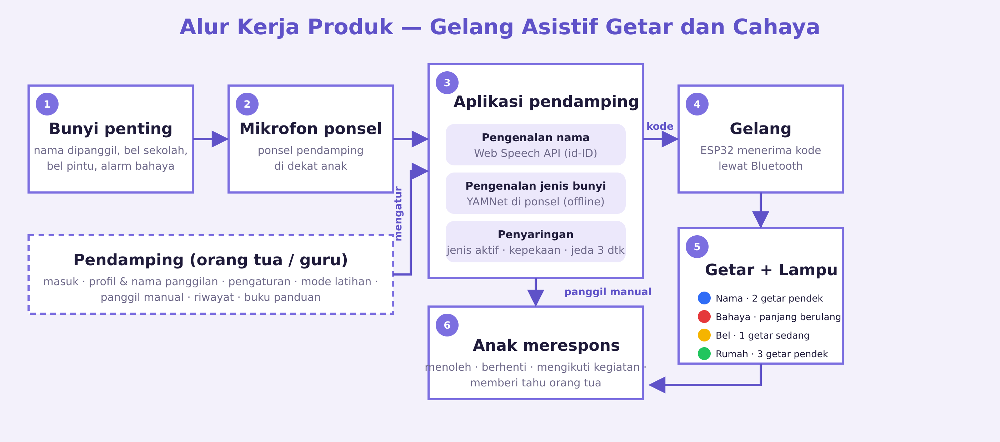

# Техническая документация: приложение Gelang Asistif

Версия 1.1, 17 октября 2026. Репозиторий: https://github.com/IvanFrost23/gelang-asistif-app. Сайт: https://gelang-asistif-3023.web.app. Документ описывает реализованное приложение после всех 12 шагов плана.

## 1. Назначение и границы

Приложение-компаньон к ассистивному браслету для глухих детей 7–12 лет. Управляется родителем или учителем. Задачи: профили детей, настройки категорий звуков, распознавание звуков с микрофона, отправка кода на браслет, история событий, guidebook и режим тренировки.

Железо не собирается. Bluetooth-подключение симулируется. Роль браслета на демонстрации играет сам телефон: анимированный браслет на экране и Vibration API на Android.



## 2. Стек

| Слой | Решение | Причина |
|---|---|---|
| UI | React 18, TypeScript, react-router-dom 6 | знакомый стек, переиспользование наработок |
| Сборка | Vite 6 | закреплено из-за Node 22.2 на машине разработки |
| Состояние | zustand 4 с persist в localStorage | работает офлайн, переживает перезагрузку |
| Распознавание речи | Web Speech API, язык id-ID | ловит имя ребёнка; доступен в Chrome без библиотек |
| Классификация звуков | YAMNet, TensorFlow.js 4.22 | готовая модель, 521 класс, работает локально |
| Вибрация | navigator.vibrate | Android Chrome |
| Аккаунты и хранение | Firebase Auth (email), Firestore | вход по email по требованию книги проекта |
| Хостинг | Firebase Hosting, проект gelang-asistif-3023 | HTTPS, нужен для микрофона |
| Локализация | свои словари ID/EN в одном модуле | две языковые версии без лишней зависимости |
| Тема | CSS-токены, `src/theme.ts`, data-theme на html | светлая и тёмная, авто по системе |
| Звук | Web Audio API, SpeechSynthesis | демо-звуки без файлов, имя голосом |
| Нативная сборка | Capacitor 6, Android | APK из того же dist/ |
| Шрифт | Plus Jakarta Sans (Google Fonts) | |

## 3. Структура проекта

```
projectT/
  docs/                   книга проекта, карточка, схема, скриншоты, руководства
  public/yamnet/          модель YAMNet (model.json + 4 шарда, 16 МБ)
  public/manifest.webmanifest, icon-*.png   PWA
  scripts/                build-docs.sh (PDF), screenshots.mjs, seed.mjs
  src/
    app/routes.ts         все пути приложения
    domain/signals.ts     четыре кода: цвет, мигание, паттерн вибрации, повтор, alwaysOn
    events/pipeline.ts    единая точка входа событий: фильтр → порог → антидребезг → история → слушатели
    listen/               режим Dengar: speech.ts, nameMatch.ts, yamnet.ts, yamnetMap.ts, yamnetClasses.ts, useListen.ts
    hooks/                useVibrate, useBraceletPlayer (анимация + вибрация), useBraceletLink (подписка на конвейер)
    store/index.ts        zustand: user, profiles, settings, bracelet, history
    i18n/                 dict.ts (ID и EN), index.tsx (контекст и переключатель)
    firebase.ts, sync.ts  инициализация Firebase и синхронизация с Firestore
    audio/demoSounds.ts   синтез звуков: звонок, сирена, дверной звонок, имя голосом
    theme.ts              тёмная/светлая тема
    components/           Screen, BottomNav, LangSwitch, Bracelet (SVG), SignalButtons, Simulator, ListenPanel, MenuRow, Toast, Icons
  android/                проект Capacitor (генерируется, собирается gradlew)
  capacitor.config.ts     appId id.ac.unesa.gelangasistif, webDir dist
    screens/              Home, Login, Profile, Connect, Settings, Training, History, Guidebook, Help
```

## 4. Маршруты

| Путь | Экран |
|---|---|
| `/` | Beranda: профиль, статус браслета, браслет, последнее событие, ручной вызов, Mode Dengar, Mode demo, меню |
| `/masuk` | вход по email |
| `/profil` | профили детей, имена-обращения |
| `/sambungkan` | симуляция подключения браслета |
| `/pengaturan` | переключатели категорий, чувствительность, аккаунт |
| `/latihan` | режим тренировки |
| `/riwayat` | история событий по дням |
| `/panduan` | guidebook: вкладки Pendamping и Anak |
| `/bantuan` | FAQ, ссылки, о проекте |

Нижняя навигация фиксирована, макет ограничен 430px и центрируется на широком экране. Переключатель языка в шапке каждого экрана, выбор хранится в localStorage.

**Дизайн.** Все цвета в токенах на `:root`; тёмная тема переопределяет их под `:root[data-theme="dark"]` и `:root.sys-dark:not([data-theme="light"])` (класс ставит `theme.ts` по matchMedia). Карточки без рамок на мягких тенях, кнопки с градиентом. Анимации: появление карточек снизу с каскадом, отклик на нажатие, покачивание браслета и «дыхание» LED в покое; всё отключается при prefers-reduced-motion.

**Браслет.** `Bracelet.tsx` рисует горизонтальный ремешок и капсульный корпус в viewBox 250×200 (внутренняя группа повёрнута на −90°), LED-полоска красится в цвет сигнала, класс `shaking` дрожит в фазе вибрации, `blinking` мигает для опасности.

## 5. Домен сигналов

Единственный источник правды в `src/domain/signals.ts`:

```ts
name:   { color: '#2f6cf6', blink: false, pattern: [150, 120, 150],           repeat: 1, alwaysOn: false }
danger: { color: '#e5383b', blink: true,  pattern: [700, 250, 700, 250, 700], repeat: 2, alwaysOn: true }
bell:   { color: '#f5b400', blink: false, pattern: [450],                     repeat: 1, alwaysOn: false }
home:   { color: '#22c55e', blink: false, pattern: [120, 90, 120, 90, 120],   repeat: 1, alwaysOn: false }
```

Паттерн в формате navigator.vibrate: вибрация, пауза, вибрация. Функция fullPattern раскрывает повторы с паузой 400 мс. Компонент Bracelet получает фазы из того же массива через useBraceletPlayer, поэтому анимация на экране и реальная вибрация совпадают по времени.

## 6. Конвейер событий

Все источники порождают одинаковое событие `{ category, source, confidence?, detail? }`, source ∈ manual | training | simulator | speech | yamnet. Функция dispatch в `src/events/pipeline.ts`:

1. Категория выключена в настройках и не alwaysOn → отбросить.
2. confidence ниже порога по чувствительности → отбросить. Пороги: речь 0.6 / 0.4 / 0.25, YAMNet 0.45 / 0.3 / 0.18 для низкой, средней, высокой чувствительности.
3. Событие той же категории было менее 3 секунд назад → отбросить (кроме тренировки).
4. Запись в историю (до 200 событий) и вызов слушателей. Браслет на главной подписан через useBraceletLink.

Режим тренировки пишет в историю напрямую, минуя фильтры, чтобы ребёнок мог пробовать любой код; с включённым «Putar suara» он тоже играет звук кода. Ручной вызов на главной произносит имя ребёнка через SpeechSynthesis.

**Демо-звуки.** `src/audio/demoSounds.ts` синтезирует звуки через Web Audio API без файлов: школьный звонок (20 ударов с партиалами колокола), сирена (пила с качанием 600–1300 Гц), дверной звонок (динь-дон E5→C5), имя ребёнка через SpeechSynthesis на id-ID. Симулятор сначала играет звук, через ≤1.2 с отправляет событие в конвейер. Функции принимают BaseAudioContext, поэтому их можно рендерить офлайн для тестов.

## 7. Режим Dengar

Хук useListen запрашивает один MediaStream и делит его между двумя распознавателями.

**Имя.** `speech.ts` оборачивает SpeechRecognition: lang id-ID, continuous, interimResults, автоперезапуск после onend, остановка при not-allowed. `nameMatch.ts` нормализует текст (нижний регистр, без диакритики и пунктуации) и ищет каждое имя профиля среди слов: точное совпадение, либо расстояние Левенштейна ≤ 1 для имён от 4 букв, либо подстрока для имён из нескольких слов. Промежуточный результат даёт confidence 0.7, финальный 0.95. Ограничение: Chrome отправляет звук в облако Google, что отражено в книге и в тексте приложения.

**Классы звуков.** `yamnet.ts` грузит граф-модель из `/yamnet/model.json` (динамический import TF.js, чанк 1.9 МБ, грузится только при старте Dengar). AudioContext с частотой 16 кГц, при другой частоте децимация. ScriptProcessor накапливает окно 15600 сэмплов (0.975 с) с перекрытием 50%, модель выдаёт [кадры, 521], кадры усредняются. В индикатор идёт лучший класс вообще, в конвейер лучший класс из карты `yamnetMap.ts`:

| Категория | Классы YAMNet |
|---|---|
| danger | Siren, Civil defense siren, Police car (siren), Ambulance (siren), Fire engine (siren), Fire alarm, Smoke detector, Vehicle horn, Car alarm, Air horn, Emergency vehicle, Alarm, Buzzer, Train horn, Foghorn |
| bell | Bell, Church bell, Chime, Alarm clock, Bicycle bell, Ringtone, Telephone, Telephone bell ringing, Wind chime, Jingle bell, Tubular bells, Whistle |
| home | Doorbell, Ding-dong, Ding, Knock, Door, Tap, Sliding door |

Проверка без железа: Chrome с флагами `--use-fake-device-for-media-stream --use-file-for-fake-audio-capture=<wav>`. Демо-звуки из `src/audio/demoSounds.ts`, отрендеренные через OfflineAudioContext, модель распознаёт как Ringtone/Telephone (школьный звонок → bell), Siren 74–78% (→ danger) и Ding (дверной звонок → home).

## 8. Хранение и Firebase

Локально: zustand persist, ключ `gelang-asistif`, версия 1. Хранятся user (email, uid, mode local|cloud), profiles, activeProfileId, settings, bracelet, history.

Firebase подключается, если заполнен `.env.local` (шаблон `.env.example`). Вход: signInWithEmailAndPassword, при user-not-found или invalid-credential создаётся аккаунт. При auth/configuration-not-found (провайдер не включён), отсутствии сети и прочих ошибках приложение входит в локальный режим и говорит об этом. `sync.ts`: на onAuthStateChanged читает `users/{uid}`, заполняет только пустое локальное состояние, затем пишет профили и настройки с задержкой 800 мс после каждого изменения. Правила Firestore: пользователь читает и пишет только свой документ.

Ручной шаг, который нельзя сделать через CLI на бесплатном тарифе: в консоли Firebase включить Authentication → Sign-in method → Email/Password. До этого вход работает в локальном режиме.

## 9. Запуск, сборка, деплой, APK

```bash
npm install
npm run dev              # http://localhost:5173, с телефона в той же сети по IP
npm run build            # tsc + vite, результат в dist/
firebase deploy --only hosting            # сайт
firebase deploy --only firestore:rules    # правила
./scripts/build-docs.sh                   # PDF из docs/*.md
node scripts/screenshots.mjs [baseUrl]    # 15 скриншотов в docs/screens/
```

Чанки сборки: index ~230 КБ, firebase ~440 КБ, tf ~1.9 МБ (ленивый). Модель и ассеты отдаются с кэшем на год.

**APK.** Capacitor оборачивает тот же `dist/` в WebView:

```bash
export ANDROID_HOME=~/Android/Sdk JAVA_HOME=~/.jdks/openjdk-19.0.2
npm run build && npx cap sync android
cd android && ./gradlew assembleDebug      # android/app/build/outputs/apk/debug/app-debug.apk
```

Релизная сборка подписывается ключом из `android/keystore.properties` (не в git), команда `./gradlew assembleRelease`. Готовый файл копируется в `docs/gelang-asistif.apk` и в `public/`, откуда раздаётся по адресу https://gelang-asistif-3023.web.app/gelang-asistif.apk. В манифесте добавлены RECORD_AUDIO, MODIFY_AUDIO_SETTINGS и VIBRATE; Capacitor сам запрашивает разрешение микрофона при getUserMedia. Иконки сгенерированы из `public/icon-512.png` в mipmap-*. Ограничение: Android WebView не поддерживает SpeechRecognition, поэтому в APK распознавание имени недоступно (панель показывает «Tidak tersedia»), а YAMNet и вибрация работают. Подпись: самоподписанный ключ `keystore/gelang.jks` (вне git), пароли в `android/keystore.properties` (вне git); applicationId `id.ac.unesa.gelangasistif`, versionName 1.1, compileSdk 34.

## 10. Проверка на устройстве

Микрофон и вибрация требуют HTTPS или localhost. С телефона: открыть https://gelang-asistif-3023.web.app в Chrome, разрешить микрофон, добавить на главный экран. Dev-сервер по IP ноутбука микрофон не даст (небезопасный origin), для этого есть флаг `chrome://flags/#unsafely-treat-insecure-origin-as-secure`.

Скриншоты для документации снимаются headless Chrome через puppeteer-core при ширине 390px, состояние засевается через `scripts/seed.mjs`.

## 11. Известные ограничения

- Полный набор функций только в Chrome на Android: речь, YAMNet, вибрация. На iPhone нет Vibration API, Web Speech API ограничен.
- Первая загрузка Dengar качает 16 МБ модели, дальше кэш браузера.
- Распознавание в шумном классе неточное; компенсируется чувствительностью, антидребезгом и ручным вызовом.
- Экран должен оставаться включённым: в фоне браузер приостанавливает аудио.
- Bluetooth и прошивка ESP32 вне рамок проекта.
