# Panduan Pengguna Aplikasi Gelang Asistif

**Gelang Asistif Getar dan Cahaya** — penanda panggilan dan suara penting untuk anak tunarungu.
Versi dokumen 1.0 (17 Oktober 2026). Panduan ini ditujukan untuk orang tua dan guru (pendamping).

Alamat aplikasi: **https://gelang-asistif-3023.web.app**

## 1. Apa itu Gelang Asistif

Banyak informasi penting di sekitar anak disampaikan lewat bunyi: nama yang dipanggil, bel sekolah, bel pintu, dan alarm bahaya. Anak tunarungu tidak dapat mengakses informasi itu secara langsung. Gelang Asistif mengubah bunyi penting menjadi dua tanda yang bisa dirasakan dan dilihat:

- **Getaran** di pergelangan tangan untuk menarik perhatian.
- **Warna lampu** untuk memberi tahu jenis suaranya.

Produk terdiri atas dua bagian:

1. **Gelang** yang dipakai anak. Berisi motor getar, lampu LED warna, baterai isi ulang, satu tombol, dan tali silikon.
2. **Aplikasi pendamping** di ponsel orang tua atau guru. Aplikasi mengenali suara, mengirim kode ke gelang, dan menyimpan pengaturan.

## 2. Empat kode yang harus dihafal

Hanya ada empat kode supaya mudah dihafal anak. Setiap kode dapat dikenali dari getarannya saja, sehingga tetap terbaca di bawah sinar matahari atau oleh anak dengan buta warna.

| Jenis suara | Warna lampu | Pola getar | Yang harus dilakukan anak |
|---|---|---|---|
| Nama dipanggil | Biru | 2 getaran pendek | Menoleh dan mencari orang yang memanggil |
| Bahaya (alarm, sirine, klakson) | Merah berkedip cepat | Getar panjang berulang | Berhenti, melihat sekitar, mendekati orang dewasa |
| Bel sekolah / penanda waktu | Kuning | 1 getaran sedang | Mengikuti kegiatan berikutnya |
| Suara rumah (bel pintu, ketukan) | Hijau | 3 getaran pendek | Memberi tahu orang tua |

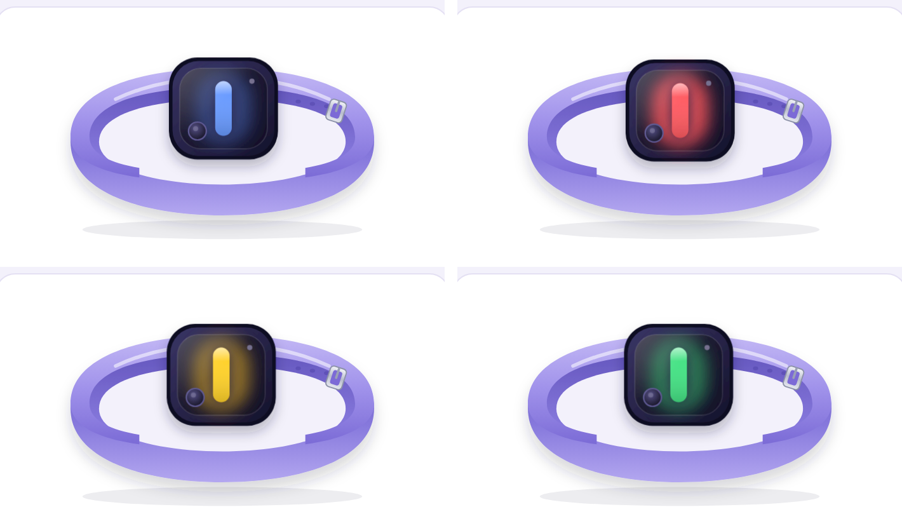

## 3. Membuka aplikasi

Aplikasi berjalan di peramban ponsel, tidak perlu dipasang dari toko aplikasi.

1. Buka **https://gelang-asistif-3023.web.app** di **Google Chrome** pada ponsel Android.
2. Pilih menu Chrome (titik tiga) → **Tambahkan ke layar utama**. Ikon aplikasi muncul seperti aplikasi biasa dan dibuka layar penuh.
3. Saat diminta, izinkan akses **mikrofon**. Izin ini dibutuhkan untuk mode Dengar (bagian 9).
4. Bahasa tampilan dapat diganti kapan saja dengan tombol **ID / EN** di pojok kanan atas.

Aplikasi juga bisa dibuka di laptop untuk presentasi, tetapi getaran hanya terasa di ponsel Android.

## 4. Masuk dengan email

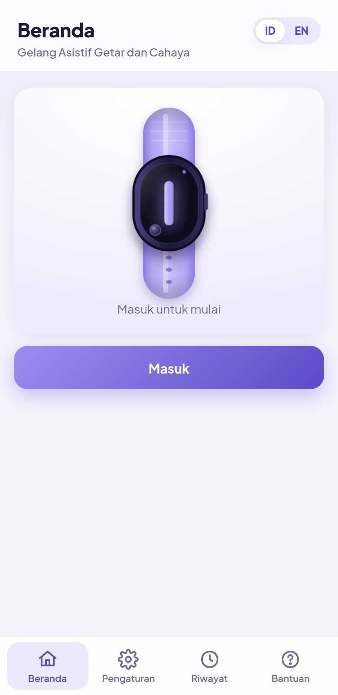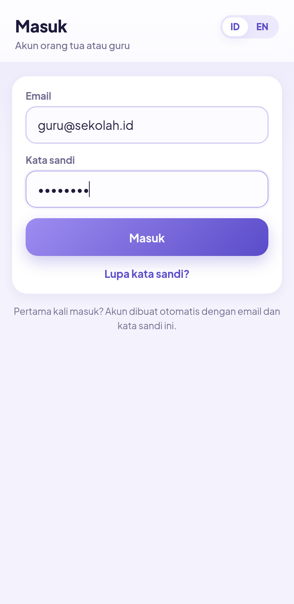

1. Pada layar **Masuk**, isi email dan kata sandi pendamping.
2. Saat pertama kali masuk, akun dibuat otomatis dengan email dan kata sandi tersebut.
3. Satu akun dapat menyimpan lebih dari satu profil anak, jadi guru dapat memakai satu akun untuk beberapa siswa. Profil dan pengaturan tersimpan di akun dan dapat dibuka dari ponsel lain.
4. Jika server tidak tersedia, aplikasi tetap berjalan dalam **mode lokal**: semua data disimpan di ponsel ini saja.

## 5. Membuat profil anak

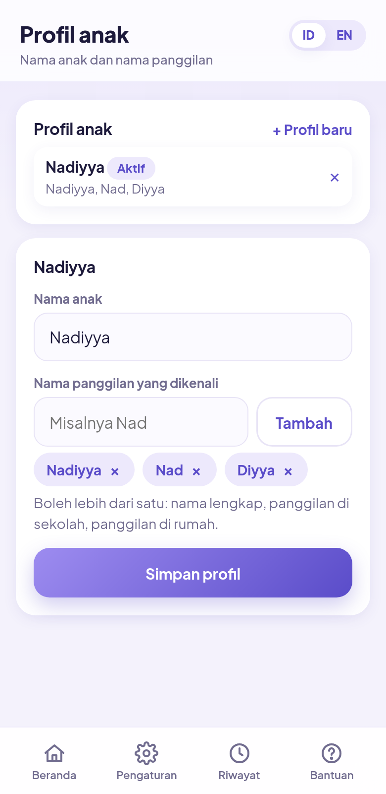

1. Dari **Beranda**, buka **Profil anak**.
2. Isi nama anak.
3. Isi **nama panggilan** yang biasa dipakai untuk memanggil anak dan tekan **Tambah**. Boleh lebih dari satu, misalnya nama lengkap, nama panggilan di sekolah, dan panggilan di rumah. Semua nama ini akan dikenali oleh aplikasi.
4. Tekan **Simpan profil**. Profil yang aktif ditampilkan di bagian atas Beranda. Untuk anak lain, tekan **+ Profil baru**.

## 6. Menyambungkan gelang

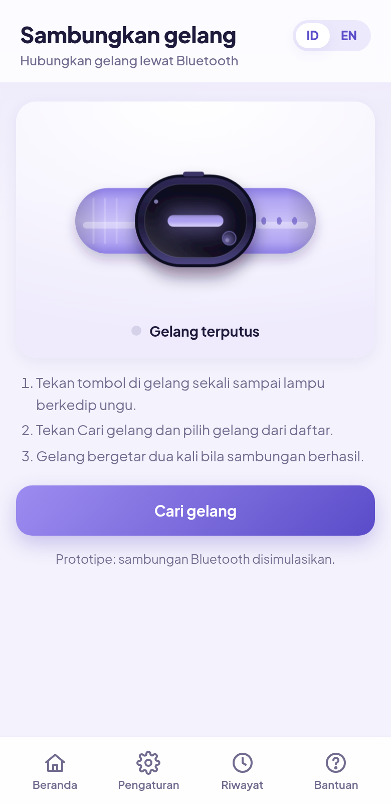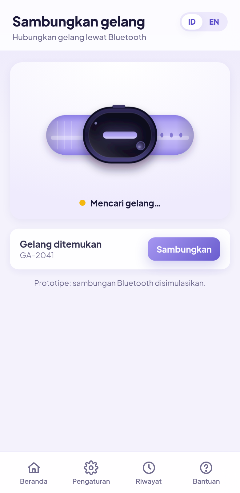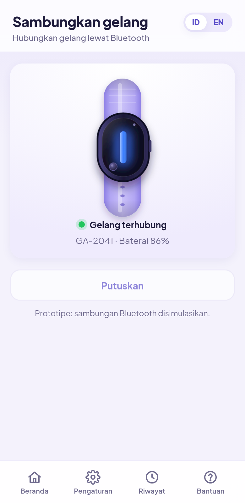

1. Nyalakan gelang dengan menekan tombol sekali. Lampu akan berkedip ungu tanda gelang siap.
2. Di aplikasi, buka **Sambungkan gelang** dan tekan **Cari gelang**.
3. Pilih gelang dari daftar dan tekan **Sambungkan**. Status di Beranda berubah menjadi **Gelang terhubung**.
4. Gelang akan bergetar dua kali sebagai tanda sambungan berhasil.

Catatan: pada prototipe ini sambungan Bluetooth disimulasikan. Semua kode dapat dicoba langsung di layar ponsel, dan ponsel Android akan ikut bergetar sesuai pola.

## 7. Beranda

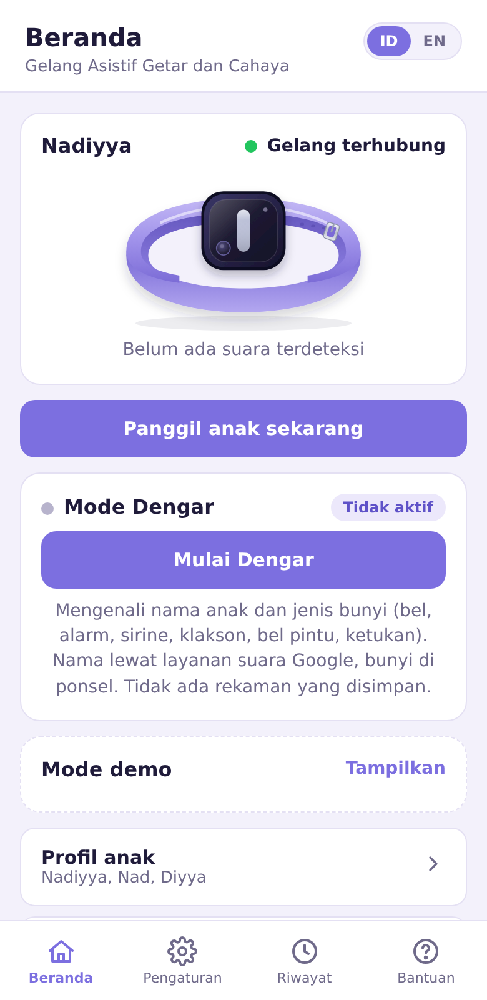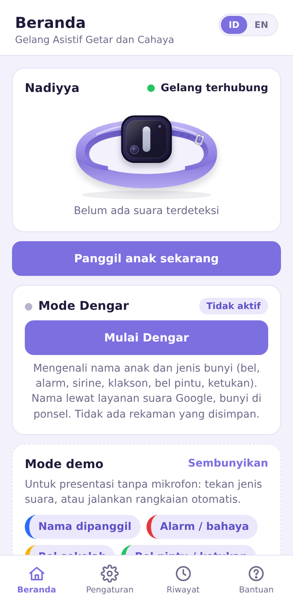

Beranda menampilkan nama anak, status gelang, gambar gelang yang menyala sesuai kode terakhir, waktu suara terakhir, tombol **Panggil anak sekarang**, panel **Mode Dengar**, panel **Mode demo**, dan menu ke layar lain.

## 8. Pengaturan suara

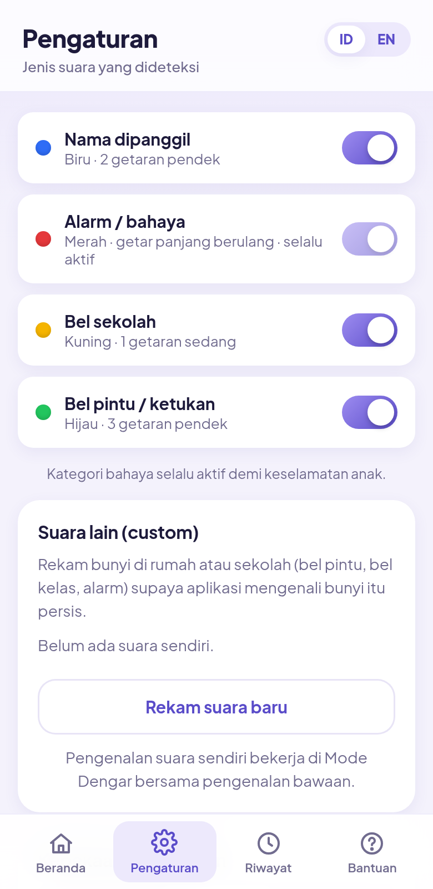

Buka tab **Pengaturan** di bagian bawah layar.

- **Saklar tiap jenis suara.** Matikan jenis suara yang tidak diperlukan, misalnya "Bel pintu" ketika anak di sekolah, supaya gelang tidak terlalu sering bergetar.
- **Bahaya selalu aktif.** Kategori ini tidak dapat dimatikan demi keselamatan anak.
- **Kepekaan.** Pilih **Rendah** jika aplikasi terlalu sering salah mendeteksi di tempat ramai, atau **Tinggi** jika suara sering terlewat.
- Pengaturan tersimpan otomatis. Di bagian **Akun** terlihat email yang masuk dan tombol **Keluar**.

## 9. Mode Dengar (pengenalan suara)

Mode Dengar membuat aplikasi mendengarkan sekitar lewat mikrofon ponsel dan mengirim kode ke gelang secara otomatis.

1. Di Beranda, tekan **Mulai Dengar**. Saat pertama kali, aplikasi mengunduh model pengenalan suara (16 MB); tunggu sampai status menjadi **Mendengarkan**. Berikutnya model sudah tersimpan di ponsel.
2. Letakkan ponsel di dekat anak, misalnya di meja kelas atau di saku pendamping, dengan aplikasi tetap terbuka dan layar menyala.
3. Panel menampilkan dua baris: **Pengenalan nama** (kata yang terdengar) dan **Pengenalan bunyi** (jenis bunyi yang terdengar saat ini, misalnya Siren 74%). Titik hijau berarti pengenal itu aktif. Ketika nama anak disebut atau terdengar bel, alarm, klakson, bel pintu, atau ketukan, aplikasi mengirim kode ke gelang dan mencatatnya di **Riwayat**.
4. Tekan **Berhenti** untuk mematikan mode Dengar.

Hal yang perlu diketahui:

- Pengenalan nama memakai layanan pengenalan suara Google di Chrome, sehingga potongan suara dikirim ke internet. Pengenalan jenis bunyi (bel, alarm, ketukan) diproses sepenuhnya di ponsel. Tidak ada rekaman yang disimpan.
- Di tempat ramai pengenalan bisa keliru. Suara yang sama tidak akan memicu gelang dua kali dalam 3 detik. Gunakan pengaturan kepekaan dan tombol panggil manual.
- Mode Dengar bekerja paling baik di Chrome pada Android. Di iPhone pengenalan nama terbatas dan ponsel tidak bergetar.

## 10. Tombol panggil manual dan Mode demo

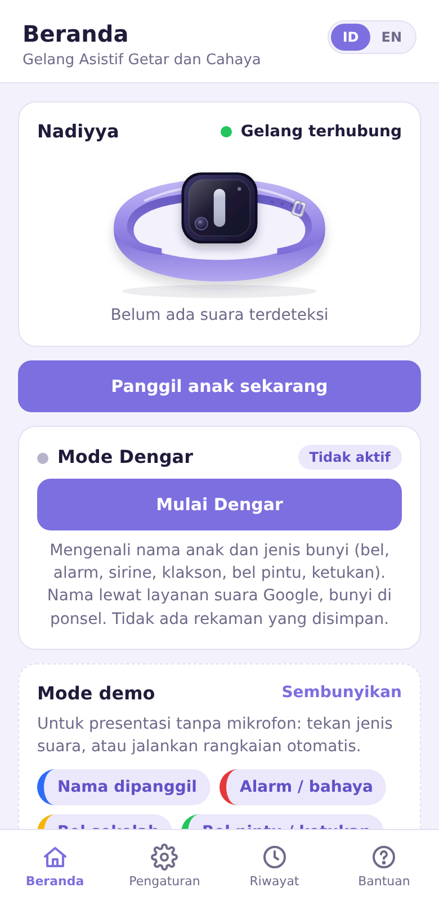

Jika pengenalan suara gagal atau pendamping ingin memanggil anak langsung, tekan tombol besar **Panggil anak sekarang** di Beranda. Gelang bergetar dengan kode "Nama dipanggil" (biru, 2 getaran pendek).

**Mode demo** dipakai untuk presentasi: tekan **Tampilkan**, lalu tekan salah satu jenis suara, atau tekan **Jalankan rangkaian demo** supaya aplikasi memutar contoh satu per satu. Dengan saklar **Putar suara** menyala, ponsel membunyikan suara yang sesuai lewat speaker: bel sekolah, sirine, bel pintu, dan nama anak yang diucapkan. Jadi di presentasi bisa dipakai dua ponsel: satu memutar demo, satu lagi dalam Mode Dengar mengenali suaranya. Semua kejadian demo juga masuk ke Riwayat.

## 11. Mode latihan

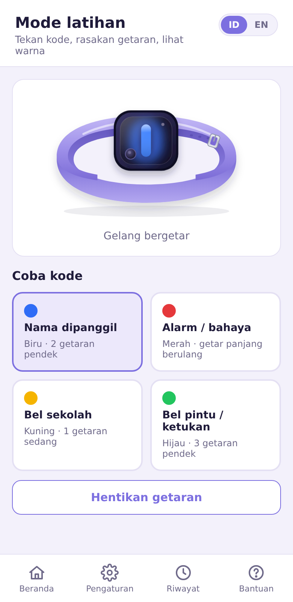

Gelang hanya bermanfaat bila anak memahami kodenya. Mode latihan membantu anak berlatih.

1. Dari Beranda, buka **Mode latihan**.
2. Tekan salah satu dari empat tombol kode. Gelang di layar menyala dengan warna yang sesuai, ponsel dan gelang sungguhan bergetar dengan pola yang sesuai.
3. Tanyakan kepada anak (dengan isyarat) kode apa yang baru dirasakan dan apa yang harus dilakukan.
4. Ulangi sampai anak hafal keempat kode. Lakukan latihan singkat setiap hari pada minggu pertama.

## 12. Riwayat

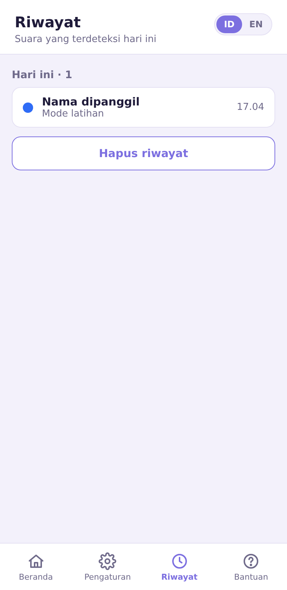

Tab **Riwayat** mencatat setiap suara yang dikenali, dikelompokkan per hari: jenis suara, sumber (nama dikenali, suara dikenali, panggil manual, latihan, demo), tingkat keyakinan, dan waktu. Riwayat membantu pendamping melihat seberapa sering anak menerima tanda dan apakah pengaturan kepekaan sudah tepat. Tombol **Hapus riwayat** mengosongkan daftar.

## 13. Buku panduan dan Bantuan

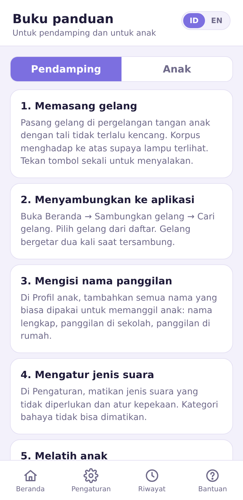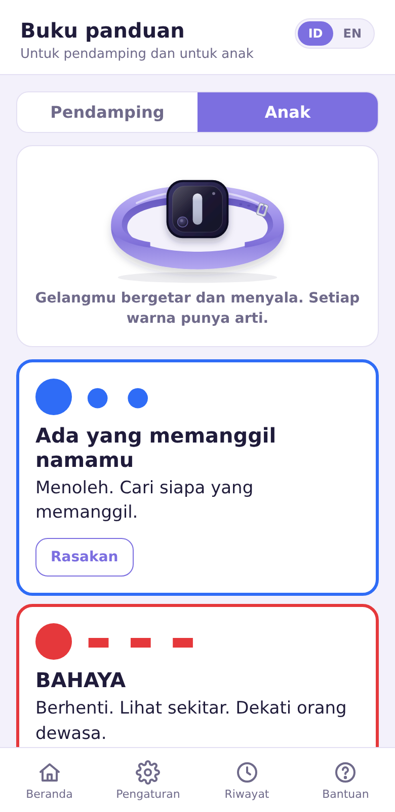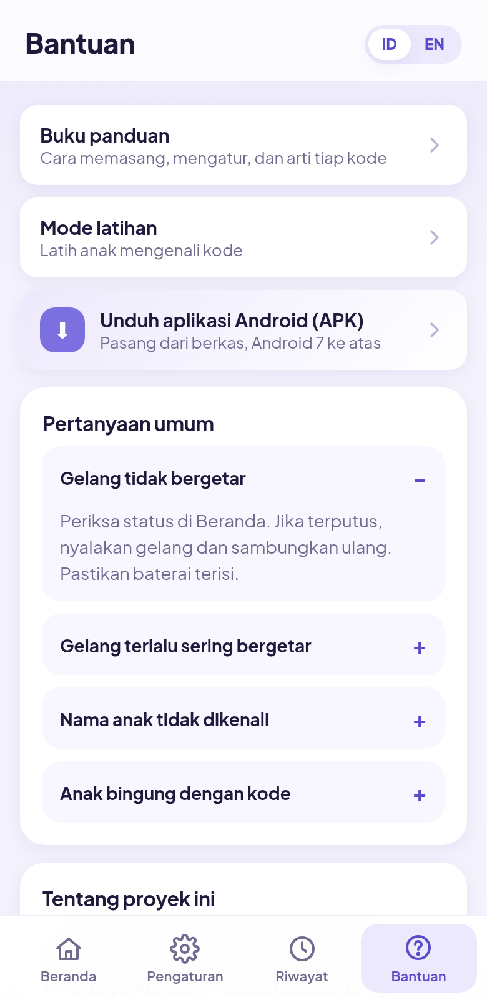

Tab **Bantuan** berisi tautan ke **Buku panduan**, pertanyaan umum, dan informasi tim. Buku panduan punya dua halaman:

- **Pendamping**: tujuh langkah dari memasang gelang sampai menangani pengenalan yang gagal.
- **Anak**: empat kode dengan lingkaran warna besar, pola getar, kalimat pendek tentang apa yang harus dilakukan, dan tombol **Rasakan** untuk mencoba getarannya. Halaman ini dirancang untuk ditunjukkan langsung kepada anak.

## 14. Pertanyaan yang sering diajukan

**Gelang tidak bergetar.** Periksa status di Beranda. Jika "Gelang terputus", nyalakan gelang dan sambungkan ulang. Pastikan baterai terisi.

**Gelang terlalu sering bergetar.** Matikan jenis suara yang tidak perlu di Pengaturan dan turunkan kepekaan.

**Nama anak tidak dikenali.** Tambahkan ejaan atau panggilan lain di Profil anak, misalnya "Raka" dan "Kaka". Pastikan mikrofon diizinkan dan ponsel tidak terlalu jauh.

**Mode Dengar tidak bisa dimulai.** Pastikan memakai Chrome di Android, izin mikrofon diberikan, dan ada koneksi internet saat pertama kali memuat model.

**Anak bingung dengan kode.** Gunakan Mode latihan setiap hari dan tempel kartu kode (halaman berikut) di kelas atau di rumah.

---

# Kartu Kode untuk Anak

Tempel halaman ini di dinding kelas atau di rumah.

| | Warna | Getar | Lakukan |
|---|---|---|---|
| 🔵 | **BIRU** | ● ●  (2 pendek) | Ada yang memanggil. Cari siapa. |
| 🔴 | **MERAH** berkedip | ▬ ▬ ▬ (panjang, berulang) | BAHAYA. Berhenti. Cari orang dewasa. |
| 🟡 | **KUNING** | ▬ (1 sedang) | Bel sekolah. Ikuti kegiatan berikutnya. |
| 🟢 | **HIJAU** | ● ● ● (3 pendek) | Ada tamu atau ketukan. Beri tahu orang tua. |
